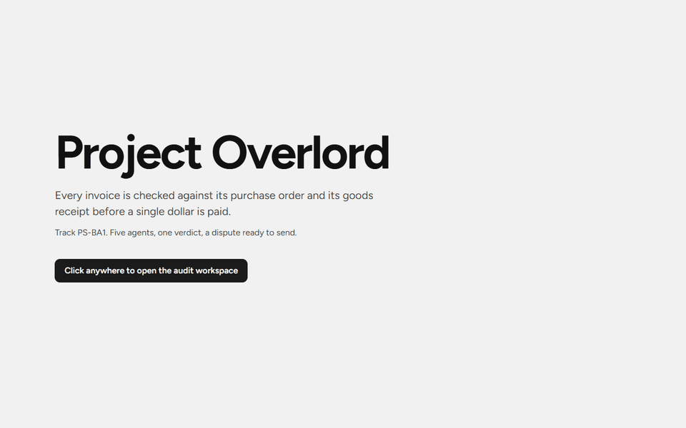
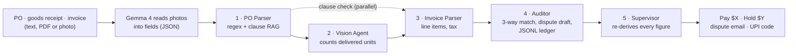
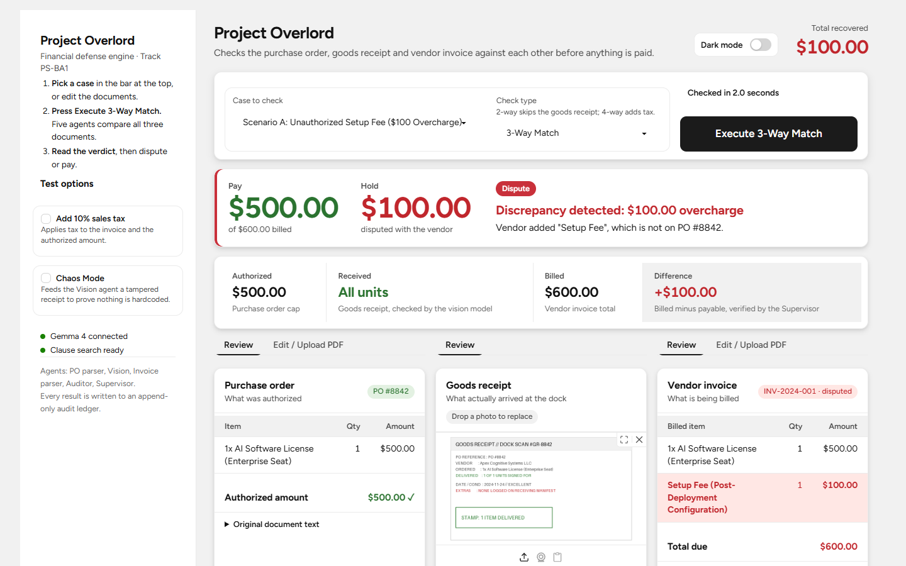
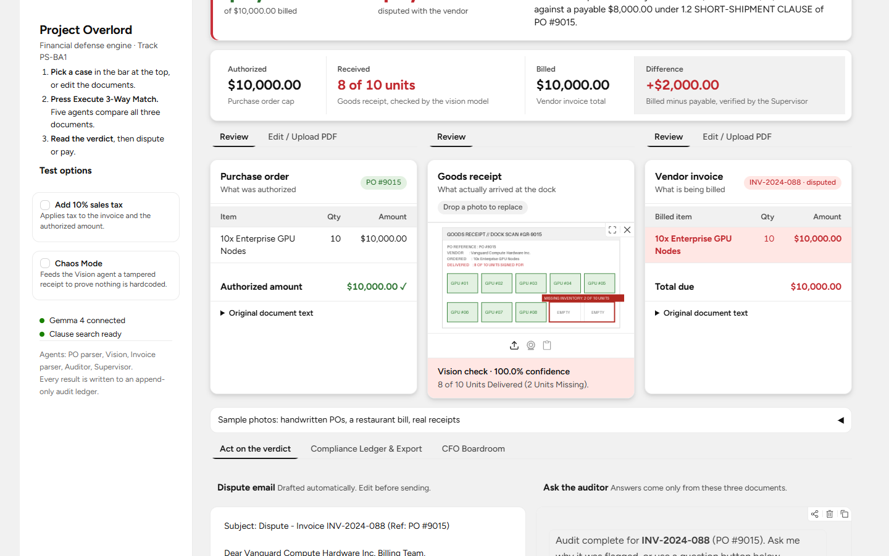
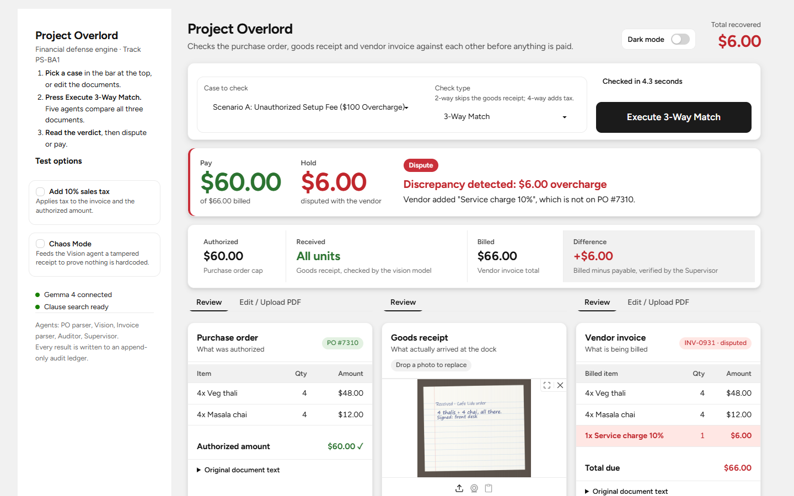
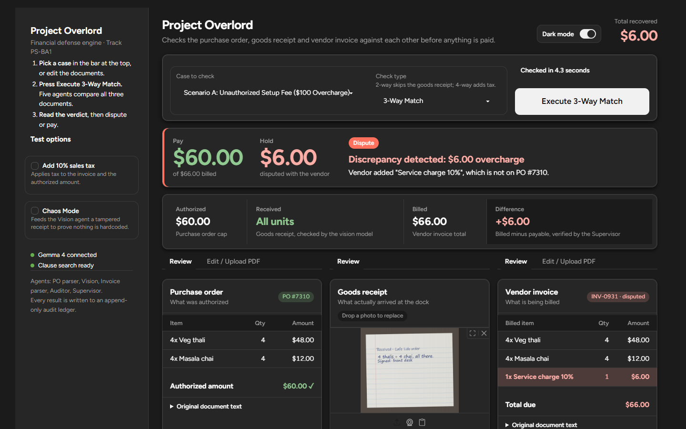
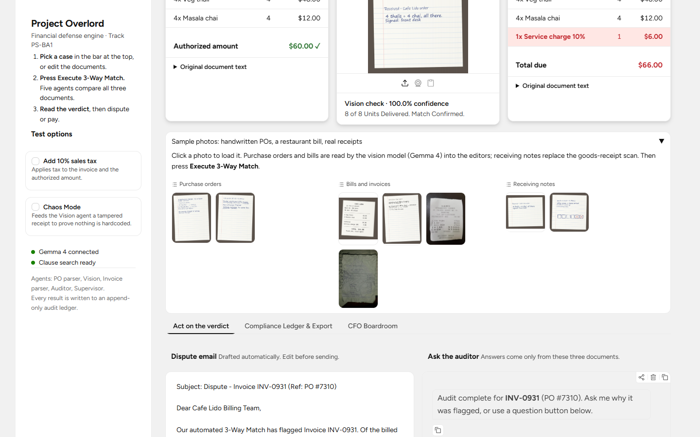
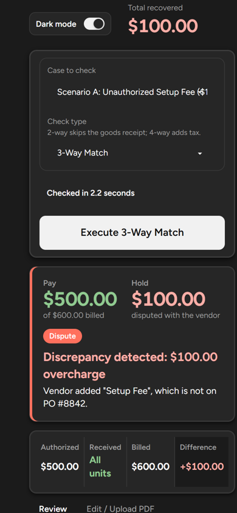

<div align="center">

# 🧾 Project Overlord — the three-way invoice check

**Pay what was ordered and delivered. Hold the rest.**

[](#why-this-matters)
[](https://auenchanters-overlord-synchron-2026.hf.space)
[](https://huggingface.co/google/gemma-4-26B-A4B-it)
[](https://github.com/langchain-ai/langgraph)
[](https://www.gradio.app/)
[](https://www.python.org/)
[](tests/)
[](pyproject.toml)

Before an invoice is paid, Overlord compares it with the **purchase order** (what was authorized) and the **goods receipt** (what actually arrived). Five LangGraph agents read the three documents, count the delivered units from a photo, and return one verdict: **Pay $X, Hold $Y**, with the disputed lines flagged, a clause-cited dispute email drafted, and an append-only audit record written. Documents can be typed, PDFs, or **phone photos of handwritten notes and restaurant bills**, read by **Gemma 4** through Hugging Face Inference Providers.

> **On the bundled photo samples: Gemma 4 read `6 / 6` document totals exactly (≈2 s each), and every three-way check returned the correct Pay / Hold.** The money math never comes from the model: a Supervisor agent re-derives every figure.

### ▶ [Open the live app](https://auenchanters-overlord-synchron-2026.hf.space)



</div>

---

## Table of contents

- [Why this matters](#why-this-matters)
- [Results](#results)
- [How it works](#how-it-works)
- [Screenshots](#screenshots)
- [Try it in two minutes](#try-it-in-two-minutes)
- [Quickstart](#quickstart)
- [Configuration](#configuration)
- [Testing and benchmarks](#testing-and-benchmarks)
- [Project structure](#project-structure)
- [Design decisions](#design-decisions)
- [Credits and licences](#credits-and-licences)

---

## Why this matters

Accounts-payable teams match three records by hand: the purchase order, the goods receipt from the dock, and the vendor's invoice. Under Net-30 pressure the usual leaks get through:

- **Uncontracted extras**: a "setup fee" or a 10% service charge that was never on the PO.
- **Short shipments**: 10 GPUs billed, 8 delivered.
- **Paper that never reaches the system**: a handwritten PO, a till receipt, a receiving note with two boxes crossed out.

A two-way match (PO vs invoice) misses the short shipment by design. Overlord always brings the third document in, reads it with a vision model, and turns the comparison into an action: a dispute email for the held amount, and a UPI payment code for the verified amount only.

## Results

All numbers below were measured on this repository (Windows 11, Python 3.13, Gradio 6.32) with [`bench/benchmark.py`](bench/benchmark.py) and Lighthouse 12. Raw output: [`bench/results.json`](bench/results.json) (after) and [`bench/results_before.json`](bench/results_before.json) (before the optimisation pass).

### 1. Gemma 4 reading accuracy and latency

Model `google/gemma-4-26B-A4B-it` via Hugging Face Inference Providers, median of 3 calls per document.

| Document (in `samples/`) | Kind | Expected total | Gemma 4 read | Latency |
|---|---|---:|---:|---:|
| `set1_handwritten_po_team_lunch.jpg` | handwritten PO | 60.00 | **60.00** ✅ | 2.77 s |
| `set1_restaurant_bill_cafe_lido.jpg` | restaurant bill | 66.00 | **66.00** ✅ | 2.93 s |
| `set2_handwritten_po_office_chairs.jpg` | handwritten PO | 720.00 | **720.00** ✅ | 2.58 s |
| `set2_handwritten_invoice_office_chairs.jpg` | handwritten invoice | 760.00 | **760.00** ✅ | 2.23 s |
| `cord_v2_test_001.jpg` (real, CORD-v2) | till receipt | 91,000 | **91,000** ✅ | 2.32 s |
| `cord_v2_test_004.jpg` (real, CORD-v2) | till receipt | 174,600 | **174,600** ✅ | 2.68 s |

**End-to-end verdicts** (photo PO + photo bill + photo receiving note → 5-agent graph):

| Case | Vision count | Expected | Got |
|---|---|---|---|
| Set 1: team lunch, 10% service charge added | 8 of 8 (thalis and chai) | Pay $60.00 / Hold $6.00 | **Pay $60.00 / Hold $6.00** ✅ |
| Set 2: 6 chairs ordered, 4 received, $40 delivery fee | 4 of 6 chairs | Pay $480.00 / Hold $280.00 | **Pay $480.00 / Hold $280.00** ✅ |
| Scenario B: 10 GPUs billed, dock scan shows 8 | 8 of 10 GPUs | Pay $8,000 / Hold $2,000 | **Pay $8,000 / Hold $2,000** ✅ |

Auditor chat ("Why did you flag this?"): **1.03 s** median reply with Gemma 4. Verified live on the Space as well: the Cafe Lido set returned Pay $60 / Hold $6 in 4.1 s end to end.

### 2. Speed of a check

| | Before | After |
|---|---:|---:|
| Audit graph alone, offline engine (Scenario A / B / C) | 15 / 22 / 24 ms | 20 / 20 / 17 ms |
| Full UI run incl. streamed agent steps, offline (A / B / C) | 2.06 / 2.24 / 1.91 s | **0.90 / 0.98 / 0.80 s** |
| PO Parser node with Gemma 4 (clause check) | 0.72–0.77 s | **< 0.01 s** (now runs alongside the vision count) |
| Whole graph with Gemma 4, photo set 1 / set 2 / Scenario B | 2.79 / 3.68 / 2.09 s | **2.00 / 7.26* / 0.95 s** |

### 3. Page load

| | Before | After |
|---|---:|---:|
| Page HTML on the wire (`/`) | 352.6 KB (uncompressed) | **28.8 KB** (gzip) |
| `/config` on the wire | 152.1 KB (uncompressed) | gzip |
| Our JavaScript, raw / on the wire | 1,187 / 306 KB | **705 / 197 KB** |
| three.js on `?intro=0` (no landing page) | always downloaded | **not downloaded** |
| Lighthouse performance, `?intro=0` / landing page | 69 / 69 | **74 / 73** |
| Largest Contentful Paint, `?intro=0` / landing page | 2.06 / 2.09 s | **1.53 / 1.60 s** |
| First Contentful Paint, `?intro=0` / landing page | 0.81 / 0.82 s | **0.68 / 0.65 s** |
| Total transfer, `?intro=0` / landing page | 1,088 / 1,088 KB | **505 / 651 KB** |
| Lighthouse accessibility | 96–97 | **100** |

Lighthouse 12, desktop preset, one run per page against a local server, old and new builds side by side. Cumulative Layout Shift stays at 0.48 in both: it comes from the fonts Gradio's own frontend injects (Source Sans Pro, IBM Plex Mono) swapping in as the app mounts, which the app cannot switch off. On the live Space the same audit measured LCP 3.4 s and 1,137 KB before this pass.

### 4. Code quality and startup

| | Before | After |
|---|---:|---:|
| `ruff check .` | clean | clean |
| Tests | 6 passing | 8 passing |
| Line coverage of `app.py` | 83% | 84% |
| Test suite wall time (with coverage) | 46.4 s | **24.8 s** |
| `python app.py` → first HTTP 200 (median of 3) | 7.90 s | 7.41 s |

\* One slow vision reply from the provider in this run (the same set measured 2.21–2.65 s in the three runs before it). Latency from Hugging Face Inference Providers varies run to run; accuracy did not. A receiving note is now checked line by line (set 1 counts the thalis and the chai, not only the larger line), and the advisory clause check no longer holds up the verdict.

Startup is dominated by importing Gradio (≈4.9 s) and LangGraph (≈1.1 s); the app's own module work is ≈0.8 s. The optional Gemini SDK is now imported only when that backend is used, which takes `google.genai` off the startup path.

### 5. Tested like a user: 18 new bills

**Round 1: 8 new bills.** Purchase orders, bills and receiving notes that were never used during development (printed and handwritten phone photos, a till receipt, typed PDFs, rupee amounts), each with a known correct answer, sent through the same upload → Execute path the UI uses, with Gemma 4 (five of them also uploaded by hand in the real UI).

| Case | Correct answer | First run | After fixes |
|---|---|---|---|
| Unit price raised from $12 to $14 (50 cables) | Pay $600 / Hold $100 | ✅ (but the email claimed a $700 overcharge) | ✅ |
| Same, with no receiving note uploaded | Pay $600 / Hold $100 | ❌ Pay $12 / Hold $688 (inspected the demo's dock scan) | ✅ "Not checked" |
| Typed PDFs with "Grand Total" / "Amount Due" | Pay $750 / Hold $0 | ❌ billed twice, Hold $750 | ✅ |
| 4 keyboards + 4 mice ordered, 2 mice missing | Pay $250 / Hold $50 | ❌ cleared (only the larger line was counted) | ✅ |
| Rupee PDFs, Rs. 1,20,000 vs INR 1,25,000 | Pay 120,000 / Hold 5,000 | ❌ fell back to the demo's $500 / $600 | ✅ |
| Till bill with a loyalty discount | Pay $180 / Hold $0 | ✅ | ✅ |
| One line over its PO price, total under the PO | Pay $140 / Hold $50 | ❌ Pay $190 / Hold $0 | ✅ |
| 12 mugs billed, 10 ordered and received | Pay $80 / Hold $16 | ✅ | ✅ |

**3 / 8 → 8 / 8.** The dispute emails, agent logs and chat answers now state the same figures as the verdict. What was fixed:

- Totals written as *Grand Total*, *Amount Due*, *Balance Due* or *Total* are read as totals, never as one more billed line.
- Amounts in ₹ / Rs. / INR / € / £ (including lakh commas) and negative discount lines are read; invoice numbers keep their slashes (`SL/24-25/118`). A document with no number or amount no longer borrows the demo's PO #8842 or $500 / $600.
- Unit prices written into an item name (`@ $12.00`, `(3 x $250.00)`) no longer stop the line from matching its PO line, so only the price difference is held.
- Pay is the bill minus everything held, so an overpriced line is held even when the invoice total is under the PO cap.
- A receiving note is counted line by line, and the demo's dock scan is never counted against a user's own PO.
- **Execute waits** while an uploaded photo is still being read. Before, a quick click ran the check on the previous document.
- Explanations name the actual problem ("billed $150 against $100", "not on the PO", "2 of 4 mice missing") and cite the PO's own clause.

The 7th test, `test_user_bills_found_in_testing`, keeps each of these fixed.

**Round 2: 10 edge cases.** A second batch aimed at harder situations:

| Edge case | Correct answer | First run | After fixes |
|---|---|---|---|
| Partial invoice: 10 ordered, 8 received, 8 billed | Pay $1,200 / Hold $0 | ✅ | ✅ |
| The same line billed twice | Pay $500 / Hold $500 | ✅ (explained only as "total exceeds payable") | ✅ "Billed again" |
| Plain `.txt` files with a "Shipping:" line | Pay $400 / Hold $25 | ✅ | ✅ |
| Nothing delivered at all | Pay $0 / Hold $900 | ✅ | ✅ |
| 12 delivered, 10 ordered and billed | Pay $1,000 / Hold $0 | ✅ | ✅ |
| Item names abbreviated on the invoice ("HP LJ Pro", "Toner 58A blk") | Pay $718 / Hold $0 | ✅ | ✅ |
| Invoice photographed sideways, with a packing charge | Pay $30 / Hold $5 | ✅ | ✅ |
| European numbers in PDFs (€1.200,00) | Pay 1,200 / Hold 50 | ❌ amounts unread, then "Cleared for payment" | ✅ |
| Price raised and 2 of 10 missing on one line | Pay $800 / Hold $300 | ✅ (the email listed only $100 of the $300) | ✅ |
| Invoice citing a different PO | Pay $0 / Hold all, needs review | ❌ paid in full | ✅ |

Robustness checks on the same build: a landscape photo, a blank page and damaged files upload as "couldn't read" (no error text, server path or raw bytes in the editor); a **scanned PDF** with no text layer, a 6000×8000 photo, a transparent PNG and a renamed `.heic` photo are all read; an emptied PO editor no longer checks a user's invoice against the demo PO; the "What if the invoice was $450?" button is answered with exact arithmetic (Gemma had declined it); off-topic and "approve full payment" chat prompts are refused. The 8th test, `test_edge_case_bills_round_two`, covers each fix.

**Known limit:** amounts are calculated correctly in any currency but always displayed with a `$` sign.

### What the optimisation pass changed

| Finding (from the measurements) | Fix |
|---|---|
| Gradio's Brotli layer only compresses paths with a file extension, so `/` and `/config` went out raw | `_GzipPages` middleware for extension-less routes (SSE streams are excluded by Starlette) |
| three.js (814 KB) downloaded and parsed before the landing page could appear, even with `?intro=0` | dynamic `import()` started when the landing page shows; tree-shaken to the 9 classes used (569 KB) |
| GSAP shipped as 5 unminified ES modules (377 KB) | one esbuild bundle, `gsap.min.js` (113 KB) |
| The advisory PO clause check (0.7 s with Gemma) sat in front of the vision call | submitted to a thread pool in node 1, collected in node 3 |
| Agent steps were paced at 150 ms each (≈2 s of every run) | 60 ms: every step is still visible, the verdict lands a second sooner |
| Figtree requested twice (theme + head), and green status text at 4.37:1 contrast | one font request; status green darkened to 4.99:1 |

## How it works



1. **PO Parser** reads the purchase order (typed, PDF via PyMuPDF, or a photo read by Gemma 4), finds the authorized amount and line items, and retrieves the governing clause (e.g. *Non-Billable Extras*, *Short-Shipment*) with section-aware chunking and hashed cosine similarity. An advisory one-line clause check by the model runs in the background.
2. **Vision Agent** sends the goods-receipt image to Gemma 4 and asks for the delivered count of every PO line and, if units are missing, a box around them. Missing stock gets a red box drawn on the scan (`MISSING INVENTORY: 2 OF 10 UNITS`). **Chaos Mode** feeds it a tampered result to show that the hold is real logic, not a script.
3. **Invoice Parser** extracts the invoice number, line items, tax and total.
4. **Auditor** matches every invoice line against the PO and the delivered count. Payable = authorized amount minus the value of undelivered units; anything above it is held. It drafts a clause-cited dispute email and writes an fsync'd record to `workspace/receipts/overlord_audit.jsonl`.
5. **Supervisor** recomputes the variance from the raw figures (`600 - 500 = 100. Calculations mathematically verified.`). If the Auditor disagrees, the Supervisor overrides it and routes to human review.

`2-Way Match` skips the goods receipt (so the short shipment passes, which is the point of the comparison); `4-Way Match` adds a tax document check. Every model call has a hard time cap; on timeout or without a token the deterministic engine answers and the log says `[FALLBACK]`.

## Screenshots

| | |
|:---:|:---:|
|  **Verdict first.** Pay $500 / Hold $100, the unauthorized setup fee flagged in the invoice. |  **Short shipment.** Gemma 4 counts 8 of 10 GPUs and the missing bays are boxed. |
|  **Photos in, verdict out.** A handwritten PO and a Cafe Lido bill read by Gemma 4: the 10% service charge is held. |  **Dark mode**, remembered per browser, with a circular View Transitions wipe. |
|  **Landing page** that dissolves into three.js dust while the workspace loads. |  **Sample photos**: handwritten POs, bills and real CORD-v2 receipts, one click each. |

<p align="center"><br><b>Phone layout</b> (390 px, dark mode)</p>

## Try it in two minutes

Open the [live app](https://auenchanters-overlord-synchron-2026.hf.space) (add `?intro=0` to skip the landing page).

1. **Scenario A** is preselected. Press **Execute 3-Way Match** → Pay $500.00 / Hold $100.00 for an unauthorized setup fee.
2. Pick **Scenario B** in *Case to check* and run → 8 of 10 GPUs delivered, Hold $2,000.00, red box on the dock scan. Switch *Check type* to **2-Way Match** and run again: it passes, because a two-way check never looks at the dock.
3. Open **Sample photos**, click the team-lunch PO, the Cafe Lido bill and the "all received" note, then run → Pay $60.00 / Hold $6.00.
4. Ask the auditor **Why did you flag this?**, press **Send Dispute to Vendor**, or **Proceed to Payment** for a UPI code covering the verified amount only.

| Sample set | Documents | Expected verdict |
|---|---|---|
| `samples/synthetic/set1_*` | handwritten PO (team lunch), Cafe Lido bill, "all received" note | Pay $60.00, hold $6.00 |
| `samples/synthetic/set2_*` | handwritten PO (6 chairs), handwritten invoice with a delivery fee, note with 2 boxes crossed out | Pay $480.00, hold $280.00 |
| `samples/real/cord_v2_*` | real restaurant receipts from [CORD-v2](https://huggingface.co/datasets/naver-clova-ix/cord-v2) with ground truth | totals read exactly |

Your own paper works too: photograph a PO or any bill in **Edit / Upload PDF** (file or webcam), or hold a receiving note up to the goods-receipt camera.

## Quickstart

```bash
pip install -r requirements.txt
cp .env.example .env        # optional: add HF_TOKEN to turn on Gemma 4
python app.py               # http://127.0.0.1:7860
```

Without a token the deterministic engine runs every check offline. One-command launchers: `./run.sh` (macOS/Linux) or `.\run.ps1` (Windows), each with `--test` / `-Test` and `--docker` / `-Docker`.

**Docker**

```bash
docker build -t overlord .
docker run --rm -p 7860:7860 --env-file .env overlord
```

**Hugging Face Space**: the YAML block at the top of this README is the Space configuration. Add `HF_TOKEN` under *Settings → Variables and secrets*.

## Configuration

| Variable | Default | Description |
|---|---|---|
| `HF_TOKEN` | *(empty)* | Turns on Gemma 4 for photo reading, the vision count, the clause check and the auditor chat. |
| `GEMMA_MODEL` | `google/gemma-4-26B-A4B-it` | Any chat model served by Inference Providers. |
| `HF_PROVIDER` | `auto` | Inference provider (`auto` picks the first available). |
| `GOOGLE_API_KEY` | *(empty)* | Optional Gemini backend, used when there is no `HF_TOKEN` or with `OVERLORD_LLM_PROVIDER=gemini`. |
| `OVERLORD_LIVE_LLM` | `1` | `0` forces the offline engine (tests and CI). |
| `OVERLORD_VISION_TIMEOUT` / `OVERLORD_TRANSCRIBE_TIMEOUT` | `15` / `30` | Seconds before a vision call gives up and the offline engine answers. |
| `OVERLORD_WORKSPACE_DIR` | `./workspace` | Where the audit ledger and exported certificates are written. |
| `GRADIO_SERVER_PORT` / `PORT` | `7860` | Web server port. |

## Testing and benchmarks

```bash
OVERLORD_LIVE_LLM=0 python -m pytest -q      # 8 tests, offline, ~20 s
ruff check .
python bench/benchmark.py                    # code quality, boot, page weight, engine speed
python bench/benchmark.py --live             # + Gemma 4 accuracy and latency on samples/ (needs a Hugging Face login)
```

The tests cover live-edited and PDF documents, photo-read documents through the full audit, the grounded chat and its off-topic guardrail, Chaos Mode and certificate export, dispute and payment flows on all three scenarios, and that the motion scripts are served as JavaScript with the page config gzip-compressed. CI ([`.github/workflows/ci.yml`](.github/workflows/ci.yml)) runs ruff and pytest on Python 3.10, 3.12 and 3.13 and smoke-tests the Docker image.

## Project structure

```
app.py                  documents + RAG, 5-node LangGraph, Gemma 4 / Gemini client, Gradio UI (Astryx Neutral tokens)
static/overlord_motion.js   landing page + three.js dust, GSAP dashboard motion, theme switch
static/vendor/          gsap.min.js, three.min.js (esbuild bundles) + LICENSES.md
samples/                photo sets 1-2 (synthetic, make_samples.py) and CORD-v2 receipts with ground truth
bench/benchmark.py      the measurements in this README -> bench/results.json
tests/                  offline pytest suite (conftest isolates the ledger per test)
docs/                   demo script, pitch prep PDF, media/ (README screenshots and GIF)
workspace/              runtime ledger (receipts/) and exported certificates (exports/)
Dockerfile · run.sh · run.ps1 · .github/workflows/ci.yml
```

## Design decisions

- **The model reads; code decides.** Gemma 4 turns photos into JSON fields and counts units. Payable, held and variance amounts are computed by plain Python, and the Supervisor checks them again. A model mistake can at worst misread a field, which shows up in the editor before you run the check.
- **No LoRA fine-tune.** Gemma 4 already reads handwriting and till receipts exactly on the samples above; Inference Providers serve the base model only; and a LoRA on a 26B mixture-of-experts model needs paid GPUs. A strict JSON prompt keeps it free.
- **Always a fallback.** Every call has a wall-clock cap, and the offline engine gives the same verdicts on the preset cases, so a demo never stalls on the network.
- **Verdict first.** The interface follows the Astryx Neutral design system (grayscale, one dark primary action, colour only for status) and shows Pay / Hold right under the run bar, then the evidence.
- **Motion that conveys state.** The landing page doubles as the loading screen; agent steps, the verdict stamp and the recovered-amount count-up animate only when a value changes, and everything honours reduced motion.

Pitch material: [docs/DEMO_SCRIPT.md](docs/DEMO_SCRIPT.md) and [docs/Project_Overlord_Pitch_Prep_and_Script.pdf](docs/Project_Overlord_Pitch_Prep_and_Script.pdf).

## Credits and licences

- Hackathon submission for track **PS-BA1** (autonomous three-way invoice, purchase order and goods-receipt reconciliation).
- [Gemma 4](https://huggingface.co/google/gemma-4-26B-A4B-it) (Google) via [Hugging Face Inference Providers](https://huggingface.co/docs/inference-providers); [LangGraph](https://github.com/langchain-ai/langgraph); [Gradio](https://www.gradio.app/); [PyMuPDF](https://pymupdf.readthedocs.io/).
- Real receipts from [CORD-v2](https://huggingface.co/datasets/naver-clova-ix/cord-v2) (Park et al., CC BY 4.0). Synthetic samples are made up by `samples/make_samples.py`.
- Vendored [three.js](https://github.com/mrdoob/three.js) (MIT) and [GSAP](https://gsap.com) (standard no-charge licence); design tokens from [Astryx](https://github.com/meta/astryx) (MIT); motion timings from [Arc](https://github.com/kuratlielia/arc-library) (MIT). Details in [static/vendor/LICENSES.md](static/vendor/LICENSES.md).
